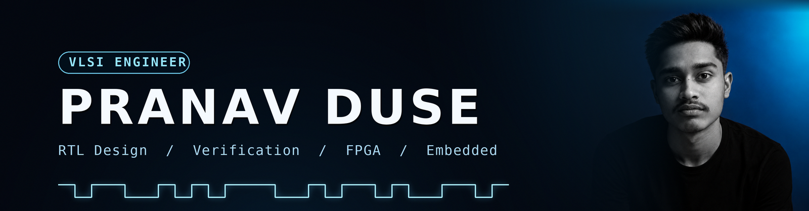
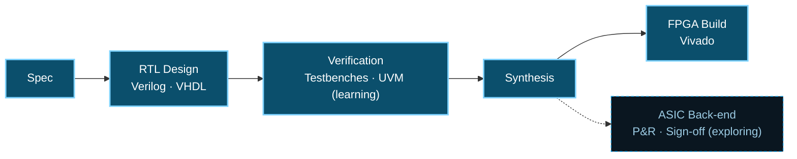

 

  

 

<h2 align="center"> Where I Work in the Chip Design Flow</h2>

Solid = hands-on &nbsp;·&nbsp; Dashed = exploring

 

<h2 align="center"> Featured Projects</h2>

<!-- Swap each link below with the exact repo URL -->

<table>
  <tr>
    <td></td>
    <td></td>
  </tr>
  <tr>
    <td></td>
    <td></td>
  </tr>
</table>

 

<h2 align="center"> Toolbox</h2>

<table>
  <tr>
    <td align="center"><b>HDL &amp; Verification</b></td>
    <td>
      
      
      
      
      
    </td>
  </tr>
  <tr>
    <td align="center"><b>FPGA &amp; EDA</b></td>
    <td>
      
      
      
      
    </td>
  </tr>
  <tr>
    <td align="center"><b>Programming</b></td>
    <td>
      
      
      
      
    </td>
  </tr>
  <tr>
    <td align="center"><b>Embedded &amp; Hardware</b></td>
    <td>
      
      
      
      
      
    </td>
  </tr>
  <tr>
    <td align="center"><b>Robotics &amp; Workflow</b></td>
    <td>
      
      
      
      
      
    </td>
  </tr>
</table>
Bright = daily use &nbsp;·&nbsp; Dark = used in projects / learning

 

<h2 align="center"> GitHub Metrics</h2>

  

 

<h2 align="center"> Highlights</h2>

  
    
  

 

  
Ask me about <b>Verilog</b>, <b>VHDL</b>, <b>RISC-V</b>, <b>Vivado</b> or <b>PCB design</b> &nbsp;·&nbsp; 📧 <a href="mailto:dusepranav@gmail.com">dusepranav@gmail.com</a>

  <code>always @(posedge clk) learning &lt;= learning + 1;</code>

 

